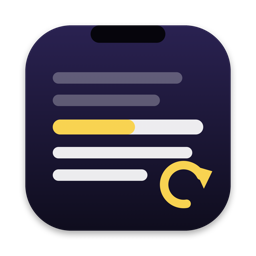

<p align="center">
  
</p>

<h1 align="center">Takeline</h1>

<p align="center">
  <strong>A teleprompter for Mac that follows your voice, in French and English, entirely on your Mac.</strong>
</p>

<p align="center">
  Based on <a href="https://github.com/f/textream">Textream</a> by Fatih Kadir Akın.
</p>

<p align="center"><a href="https://github.com/Bouliw/takeline/actions/workflows/tests.yml"></a></p>

---

Takeline shows your script right below the MacBook notch, in a floating window, fullscreen or on another display, and highlights each word as you say it. It keeps everything Textream does and adds what you need to record videos in one go:

- **100 % local.** Speech recognition runs on your Mac with Apple's SpeechAnalyzer. Audio never leaves it: when a language isn't available on the Mac, Takeline says so instead of using a server. No account, no analytics, no network request unless you turn on the update check.
- **French, English, or both.** The language is detected from the script, and a script that mixes the two is followed in both at once. You can also pick the language by hand.
- **Robust tracking.** It tolerates misheard words, waits while you improvise, goes back when you re-read a sentence and jumps when you skip a line. Names in the script help the recognizer spell them.
- **Retakes.** Say "on la refait", "je reprends", "take two", "scratch that"… or simply read the sentence again: the text goes back to the start of the sentence and the retake is noted with its time. The same words inside your script or your story are ignored; when a phrase is ambiguous, Apple's on-device model decides from the context.
- **Voice commands**, in French or English: previous paragraph, from the top, pause, resume, bigger or smaller text.
- **Session files for editing.** At the end of a reading, Takeline can save the script and every take to a `.takeline.json` file an editing tool can use to keep the good takes. See [the format](docs/session-format.md).
- **More imports.** Word (.docx), Markdown (.md) and text (.txt), besides PowerPoint notes and `.textream` files.
- **Secured remote view and Director.** Both ask for an access code (carried in the QR code) and refuse devices outside the local network, by default.
- **Estimated video length**, at your own reading pace, learned from your sessions.
- **English and French interface.**

## Install

1. Download `Takeline.dmg` from the [latest release](https://github.com/Bouliw/takeline/releases/latest), open it and drag Takeline into Applications.
2. Open Takeline. It is not signed by an identified developer yet, so the first time macOS stops it: click **Done**, then open **System Settings › Privacy & Security**, scroll down to **Security** and click **Open Anyway**.
3. In **Settings › Voice**, click **Install** next to each language you speak: Apple's speech model for that language is downloaded once.

## Features

### Guidance modes

| Mode | What it does | Microphone |
|---|---|---|
| **Word tracking** (default) | Highlights each word as you say it, with retakes and voice commands. | Yes |
| **Classic** | Scrolls at a constant speed. | No |
| **Voice-activated** | Scrolls while you speak, stops when you're silent. | Yes |

Pause works in every mode, from the prompter or by voice. Tap a word to jump to it. Scroll with the mouse to catch up in the classic and voice-activated modes.

### Where the text appears

- **Pinned to the notch**, following the mouse across displays or fixed on one.
- **Floating window**, optionally following the cursor, with a glass effect.
- **Fullscreen** on any display (Esc to stop).
- **External display or Sidecar iPad**, as a teleprompter or mirrored for prompter glass (horizontal, vertical or both).
- **Hidden from screen sharing** and recordings, on every display, by default.

### Remote view (any phone, tablet or computer)

Enable it in **Settings → Remote** and scan the QR code: the prompter opens in the browser of any device on the same network, with live highlighting, the waveform and a mirror option. Add the page to your iPhone's home screen and it behaves like an app. The QR code carries the access code; nothing to install.

### Director mode

Someone else writes, edits and sends the script from a browser while you read. The director's script never replaces yours: your pages and your file stay as they were. To build your own director client, see [the API](docs/director-api.md).

### Files

- Scripts from **PowerPoint** presenter notes (in slide order), **Word**, **Markdown** (a line of `---` starts a new page) and **text** files. Drop them on the window or use **File → Open**.
- Save and reopen your scripts as `.textream` files, compatible with Textream.
- Several pages per script, with automatic next page.

### Also

- Live waveform, last spoken words, elapsed time, paragraph dividers.
- Sans, serif, mono and OpenDyslexic fonts; highlight and cue colors.
- `takeline://read?text=Hello%20world` URL scheme and a **Read in Takeline** Services menu item.

## Privacy

Takeline only listens while the prompter is open in word tracking or voice-activated mode, and recognizes speech on the Mac only. The speech model for each language comes from Apple, once, when you click **Install** in **Settings → Voice**. Retakes and commands are understood by Apple's on-device model when Apple Intelligence is on, and by simple rules otherwise. Session files are written to a folder you choose, and nowhere else.

## Requirements

- macOS 26 or later.
- Apple Intelligence (optional) for understanding ambiguous retake phrases from their context.

## Build from source

1. Install Xcode 26 or later.
2. Clone the repository and open `Textream/Textream.xcodeproj`.
3. Choose the **Textream** scheme and **My Mac**, then **Product → Run** (⌘R).

The tracking, retake and import logic lives in the `TakelineCore` Swift package, with its tests:

```bash
cd TakelineCore && swift test
```

### iPhone and iPad

The remote view is the simplest way to read on an iPhone or iPad. The native app from Textream (reading under the camera, mirroring, recording) is in `Textream/TextreamiOS`; with a free Apple account, an app installed from Xcode stops opening after 7 days and has to be installed again.

## URL scheme

```
takeline://read?text=Hello%20world
```

## Credits

Takeline is a fork of [Textream](https://github.com/f/textream) by Fatih Kadir Akın, after an original idea by Semih Kışlar. The OpenDyslexic font is licensed under the SIL Open Font License.

## License

MIT, see [LICENSE](LICENSE).
